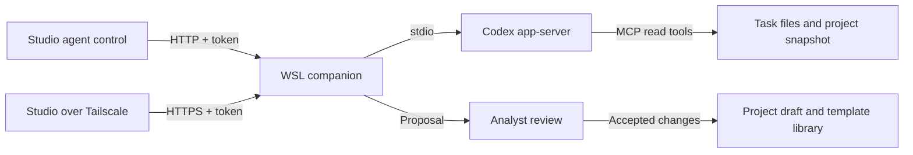

# Specification agent companion

The Studio control can use Codex installed in WSL. It uses that machine's existing
Codex login and model settings. A ChatGPT login does not require a separate API
key. Subscription limits still apply. The tested version is Codex CLI 0.162.1.

## Start the companion

From the repository root:

```sh
npm run build
codex login status
npm run companion
```

Keep that terminal open. The default address is `http://127.0.0.1:46117`.
The connection token is in `tmp/codex-companion/connection-token`. Copy it into
Studio; do not put it in a URL. Files, task records, and generated workbooks are
in `tmp/codex-companion/tasks/`. The `tmp/` directory is Git-ignored. Token and
task files use private file permissions. No token is written to the project.
The browser retains the token for the current tab session.

Reload the built extension, open a project in Specification Studio, then select
**Specification agent**. Enter the endpoint and token, then select **Connect**.
Allow Chrome to access that host. The control shows the Codex account state.

The service binds only to loopback. Options:

```sh
npm run companion -- --port 46117 --workspace tmp/codex-companion
```

Use one service process per workspace. Use Ctrl+C to stop it. Interrupted tasks
remain on disk. After restart, connect again and send feedback to resume the
saved task. If a response was lost during creation, use **Resume or retry
connection**; a repeated task identity does not start another run.

## Connect through Tailscale

Use Tailscale Serve to forward an unused HTTPS port to the local service:

```sh
tailscale serve status
tailscale serve --bg --https=8444 http://127.0.0.1:46117
```

Use the HTTPS URL that Tailscale prints, including `:8444`, in Studio on a device
in the same tailnet. Supply the same companion token. Check the tailnet access
rules if that device cannot connect. Do not replace another service's port.
On this WSL host, ports 443 and 8443 already serve other applications.

To remove only this mapping:

```sh
tailscale serve --https=8444 off
```

This uses private Tailscale Serve, not public Funnel. Plain HTTP is accepted
only for localhost. The built-in Codex WebSocket endpoint is not the Studio
endpoint: the tested version rejects a browser Origin header. The companion
provides authenticated HTTP and talks to Codex app-server over stdio.

## Draft and review

1. Choose a Page, in-page Event, Property Set, Flow, Excel import, template, or
   combined import-and-template task.
2. Enter a description. Select the allowed definitions and Shared Profile
   properties. For flow work, select a Flow with its existing screenshots, or
   attach screenshots and describe their order and purpose.
3. For an Excel import, supply a stable source key. Use the same key on later
   versions of that specification. Choose `.xlsx` files; old `.xls` files must
   first be saved as `.xlsx`.
4. Select **Create draft**. Review each item, its source references, and the
   proposed matches. Select Create, Reuse, or Update and a target as needed.
   Similar names are candidate matches; they are not automatic approvals.
5. Accept, reject, or request information. Use the item feedback and revision
   feedback to refine the proposal. **Edit proposed fields** permits direct
   JSON edits. An edit resets that item's decision to Pending.
6. Select **Check accepted changes**, then **Apply accepted changes**. Accepted
   dependencies must be included. Open questions on an item block its save.

The agent cannot publish or write to the project. Studio checks references,
property selections, duplicates, and source conflicts before one draft save.
The normal Studio history can undo that save. Accepted and rejected items are
fixed during agent revision; set an item to Pending when you want it changed.
Applied items remain fixed. A changed project blocks a stale proposal. Send
feedback to refresh the context; unapplied accepted items then need review.

The screen keeps the current task per project. Starting a new task replaces
that screen's previous review. The companion keeps the earlier task on disk.

## Excel import and export templates

The reader includes hidden sheets, merged-cell metadata, values, style hints,
and formula cache warnings. It does not execute formulas. Source reads and
source coverage are checked before completion. **Inspect source cells** shows
the extracted source. Review unresolved coverage before you accept a partial
import. An import does not prove that a live website sends the specified data.

Matching uses prior source mappings, equal records, equal names or event names,
and similar names. Creation of a known duplicate is blocked. If the source and
the project both changed since an import, resolve the conflict or reuse the
current project definition. New names that share a purpose still need analyst
review; semantic equivalence cannot be proved from a name alone.

For templates, the agent maps source cells to the existing guided Excel
contract. The exporter checks bindings, repeat areas, named ranges, and the
generated workbook. It retains supported cell styles, row heights, column
widths, merges, and page settings. Source images are reported as a layout limit;
use supported theme-logo or page-visual bindings. Macros, embedded applications,
and executable formulas are not carried into the template.

Use **Preview with project data** and **Download preview workbook** to inspect
the result. Accept the template, then save it to the project. Select it in the
normal Documentation template library for the required export section. The
template body is saved with the project asset store and participates in the
existing export and archive paths.

File limits: 10 MiB per file, 25 MiB total, 30 files per task, 30,000 populated
cells per workbook, and 50 MiB expanded workbook size. Use smaller source files
for larger specifications. One Codex task runs at a time. A turn has a ten-minute
limit. An invalid proposal gets one repair attempt. The service reports model,
login, rate-limit, and task errors for retry.

## Components and checks



The companion exposes no general shell or file-write API. Its child Codex
process disables shell tools, apps, plugins, hooks, web search, and other agents.
Only five local MCP tools are enabled and pre-approved: `read_project`,
`search_definitions`, `list_workbooks`, `read_sheet`, and `validate_proposal`.
Their inputs are restricted to the task snapshot and staged source files.
Personal Codex configuration is not modified. Keep this token limited to
trusted users: it grants access to task data and use of the Codex account.

Specification checks and runtime checks are separate:

```sh
npm run typecheck
npm run build
npm run test:agent
node test/data-layer-documentation-template-excel-test.mjs
node test/agent-browser-test.mjs
node test/agent-live-codex-test.mjs --live
node test/agent-tailscale-test.mjs --live
```

The browser test uses an isolated Chrome profile, pregranted localhost access,
and fixed agent output. It tests the installed control and durable saves. It
does not test Chrome's native permission prompt. The live test uses the real
Codex login, MCP source reads, draft revision, matching, and template rendering.
The Tailscale test uses a temporary unused port and restores the prior Serve
configuration. It tests the path from this host; a second-device test remains
a separate check. The feature scenarios are in
`features/specification-agent-companion.feature`.
